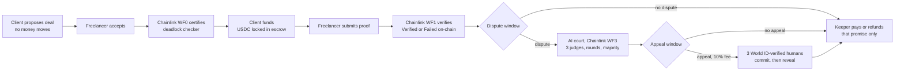

# Settld

**Per-milestone USDC escrow on Arc. Chainlink checks the work; AI judges and World ID-verified humans settle disputes.**

Live: **https://settld-backend-production.up.railway.app** (Arc testnet, test USDC only)

Built at ETHGlobal Mumbai 2026 for **Arc / Circle** (smart contracts with advanced stablecoin logic, in Arc Studio),
**Chainlink** (best workflow with CRE) and **World** (best use of IDKit).

---

## The problem

Freelancers and creators are paid on trust: deliver first and hope to be paid, or get paid first and hope the work
arrives. Contracts are vague, conditions depend on each other in ways that can trap money, and a $200 disagreement
isn't worth a lawyer.

## What Settld does

A deal is split into **promises** (milestones). Each promise has its own amount, deadline and an automatic check:

| Check | Verified by |
|---|---|
| YouTube video posted by a named channel before the deadline | YouTube Data API |
| Video description contains a text or hashtag (e.g. `#ad`) | YouTube Data API |
| Link is live / page contains a text | HTTP fetch |
| GitHub pull request merged (into a given repo) | GitHub API |
| AI check against a written brief | 3 LLMs vote (Groq gpt-oss-120b, Gemini, NVIDIA Nemotron) |



1. **Propose and accept.** The client proposes; the freelancer accepts. No money moves yet.
2. **Certify.** A Chainlink workflow reads the deal straight from the chain, recomputes its fingerprint and runs a
   **deadlock checker** that explores every state the deal can reach and proves the money can always end up paid or
   refunded (no circular dependencies, amounts add up, every check is supported). The escrow won't accept funding
   without this certificate.
3. **Fund.** The client locks the full amount (two PIN approvals: allow the escrow to take the USDC, then fund).
4. **Verify.** The freelancer submits a link; a Chainlink workflow runs that promise's check and reports Verified or
   Failed on-chain.
5. **Settle.** After a short dispute window the money for that promise alone is released to the freelancer or refunded
   to the client. One bad promise never freezes the rest of the deal.
6. **Dispute → AI court.** Either party can dispute a verdict inside the window. Three AI judges deliberate under rules
   the contract enforces (below).
7. **Appeal → human jury.** Either party can pay 10% of the disputed amount to send the case to three human
   arbitrators, each verified as a unique person with World ID.

Everyone signs in with an email code. Circle creates a wallet per user, and every transaction is approved with the
user's own PIN: Settld never holds keys or moves anyone's money. **USDC is the only money in the system**: deals, fees
and gas are all paid in USDC on Arc.

---

## How each partner technology is used

### Arc + Circle
- **Contracts** were built in **Arc Studio** and deployed on **Arc testnet**, where USDC is also the gas token. The first
  escrow was deployed straight from Arc Studio; the v2 contracts were written there and deployed with Hardhat.
- **Circle user-controlled wallets** (email OTP + PIN, smart-contract wallets on Arc) for every party. The server only
  prepares transactions; the user approves each one in Circle's PIN window.
- Per-promise settlement, cascade refunds, court-ordered splits and appeal-fee distribution all move USDC inside the
  contracts.

| Contract | Address (Arc testnet) | Role |
|---|---|---|
| `ClauseEscrow` | [`0x403C33AD…4151`](https://explorer.testnet.arc.io/address/0x403C33ADB6Fb8989EAA9E29a116996F642064151) | Holds USDC; per-promise state machine; certificate gate; disputes |
| `AICourt` | [`0xb8f86C3f…A2b0`](https://explorer.testnet.arc.io/address/0xb8f86C3f51e31c67cf27D55d788c80ac95B9A2b0) | AI deliberation limits, verdict, appeals, fee payouts |
| `JurorRegistry` | [`0xE932eCA0…bC7E`](https://explorer.testnet.arc.io/address/0xE932eCA0dEBB7A939749F035EA4209F43c42bC7E) | World ID person ↔ wallet; commit-reveal panels; strikes and suspension |

All addresses and deployment transactions: [`shared/addresses.json`](shared/addresses.json).

### Chainlink CRE
Three TypeScript workflows (compiled to WASM), each sending signed reports to the contracts through Chainlink's
forwarder. The contracts accept verification and court reports only from the forwarder.

| Workflow | Trigger | What it does |
|---|---|---|
| [`cre/wf0-certify`](cre/wf0-certify/main.ts) | Deal accepted | Reads the deal from Arc, recomputes the spec hash, runs [`shared/checker.ts`](shared/checker.ts), sends the certificate |
| [`cre/wf1-verify`](cre/wf1-verify/main.ts) | Proof submitted | Runs the promise's check (YouTube, HTTP, GitHub, or 3-LLM vote) and reports Verified / Failed |
| [`cre/wf3-court`](cre/wf3-court/main.ts) | Case opened / round completed | Runs one AI court round per execution; rules in [`court.ts`](cre/wf3-court/court.ts) |

**How it runs here:** our CRE account has simulation access only, so the server's watcher runs each workflow with
`cre workflow simulate --broadcast` when it sees the triggering event on Arc. The reports are real transactions that
reach the contracts through Chainlink's forwarder on Arc testnet. A keeper then releases or refunds each promise after
its window.

### World ID (IDKit 4)
- Arbitrators sign up with **World's IDKit widget**. The server signs each request (RP context), verifies the proof
  with World's API, then signs an attestation `(nullifier, wallet)` that `JurorRegistry.registerPerson` checks
  on-chain. One person can hold only one seat.
- Strikes and suspension are stored against the **World ID nullifier**, not the wallet, so a new wallet can't reset them.
- Parties can also verify with World ID for a verified-human badge.
- The app currently uses World ID's **staging** environment, which accepts the World ID Simulator.

---

## The AI court

| Rule | Value | Enforced by |
|---|---|---|
| Judges | 3 (Groq gpt-oss-120b, Google Gemini, NVIDIA Nemotron) | WF3 |
| Evidence | `0` the promise's terms, `1` the submitted work, `2` the dispute reason | WF3 |
| Vote | `100` pay the freelancer in full, `0` refund the client | WF3 + contract |
| Round 0 | Blind, independent opinions; nobody can lock a vote | WF3 |
| Word budget | 200 words per judge for the whole case | WF3 cuts, contract rejects |
| Extensions | If 2 of 3 ask: +100 words, +60 s, +1 round; at most 2 | Contract |
| Time | 3 min, hard cap 5 min | Contract |
| Rounds | Max 3 (+1 per extension); everyone final on the last | Contract |
| Changing a vote | Only by citing evidence | WF3 |
| Verdict | Median of the three votes (with 0/100, the majority) | Contract |

**Guardrails:** evidence is wrapped in tags the models are told to treat as data, never instructions; models never pick
amounts. Each round's full transcript is stored by the server, but its **keccak hash goes on-chain** and the next round
checks it, so the server can't change what a judge said.

**Human appeal:** 10% fee → three World ID-verified arbitrators commit hidden votes (2 min), then reveal (1 min).
Majority wins; the majority shares the fee. Voting against the majority is a strike; two strikes suspend the person.
If nobody reveals, the AI verdict stands. A dispute stuck for a day can be settled on the original verdict.

---

## Repository

| Path | Contents |
|---|---|
| [`contracts/`](contracts) | Solidity: `ClauseEscrow`, `AICourt`, `JurorRegistry`, Chainlink receiver base. Hardhat + Foundry tests, deploy script |
| [`cre/`](cre) | Chainlink CRE workflows (`wf0-certify`, `wf1-verify`, `wf3-court`) and the shared LLM client (`lib/llm.ts`) |
| [`shared/`](shared) | Deal spec and fingerprint, report encoding, **deadlock checker** (used by the website and WF0), ABIs, addresses |
| [`server/`](server) | Express + TypeScript API: Circle wallets and sessions, transaction preparation, World ID, court data, watcher + keeper |
| [`client/`](client) | React 19 + Vite website (three.js scenes), served by the API server in production |
| [`scripts/`](scripts) | End-to-end tests on Arc testnet (`e2e-dispute.ts`, `e2e-checks.ts`) and test-deal helpers |
| [`docs/`](docs) | [`INTERFACES.md`](docs/INTERFACES.md) (report formats, statuses, check types), [`DEPLOY.md`](docs/DEPLOY.md), [`SETTLD_FINAL.md`](docs/SETTLD_FINAL.md) (product spec) |

Server modules worth reading: [`index.ts`](server/src/index.ts) (API and Circle transactions),
[`automation.ts`](server/src/automation.ts) (watcher + keeper), [`arbitration.ts`](server/src/arbitration.ts) (court
and arbitrator routes), [`worldid.ts`](server/src/worldid.ts) (IDKit verification and attestation),
[`court.ts`](server/src/court.ts) (transcript store), [`store.ts`](server/src/store.ts) (MongoDB / SQLite).

---

## Tests

```bash
cd contracts && npm install && npm test          # Hardhat: escrow ↔ court ↔ registry integration
cd contracts && forge test                       # Foundry: AICourt and JurorRegistry unit tests
cd shared && bun install && bun test             # deadlock checker
cd cre/wf3-court && bun install && bun test      # AI court rules
cd cre/wf1-verify && bun channel-check.test.ts   # YouTube channel check against live YouTube (needs cre/.env)
```

End-to-end on Arc testnet with test wallets (`scripts/.env`): `bun run e2e-dispute` (full dispute; `--appeal` adds the
human panel) and `bun run e2e-checks` (page, GitHub and AI checks; `--youtube` for the YouTube checks).

## Run locally

```bash
cd server && npm install && npm run dev     # API on http://localhost:3000   (server/.env, see .env.example)
cd client && npm install && npm run dev     # website on http://localhost:5173 (client/.env: VITE_CIRCLE_APP_ID)
```

Set `AUTOMATION_ENABLED=true` in `server/.env` (with the `cre` CLI logged in) to run the watcher and keeper. Deployment:
[`docs/DEPLOY.md`](docs/DEPLOY.md).

## Status and limits (honest)

- **Testnet only.** Arc testnet and test USDC; the "Add test USDC" button sends from a test treasury.
- **CRE in simulation mode.** Workflows run via the CRE CLI on our automation host, not on a deployed Chainlink DON.
  Reports are real on-chain transactions through Chainlink's forwarder.
- **Demo timings.** Dispute and appeal windows are 2 minutes so a full case fits in a demo.
- **AI judges read text.** For a video they read its title, channel and description; they can't watch it.
- **Disputing is free** (gas only); a refundable dispute bond is the planned next step.

## Team

Mehak (backend, CRE workflows, deadlock checker, AI court) · Samagra (smart contracts, Arc Studio) · Purva (frontend,
design).

No keys or `.env` files are committed. Server settings are listed in [`server/.env.example`](server/.env.example);
CRE secret names in [`cre/secrets.yaml`](cre/secrets.yaml).
